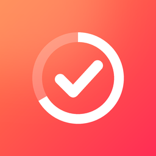
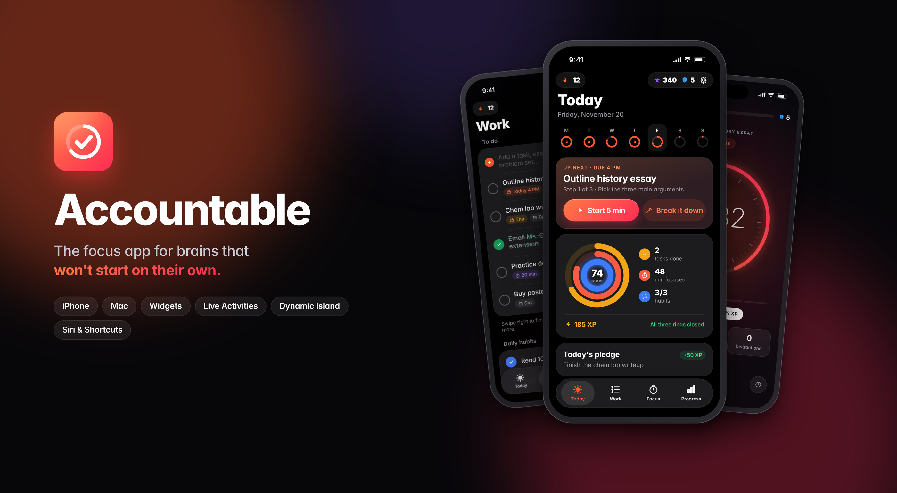
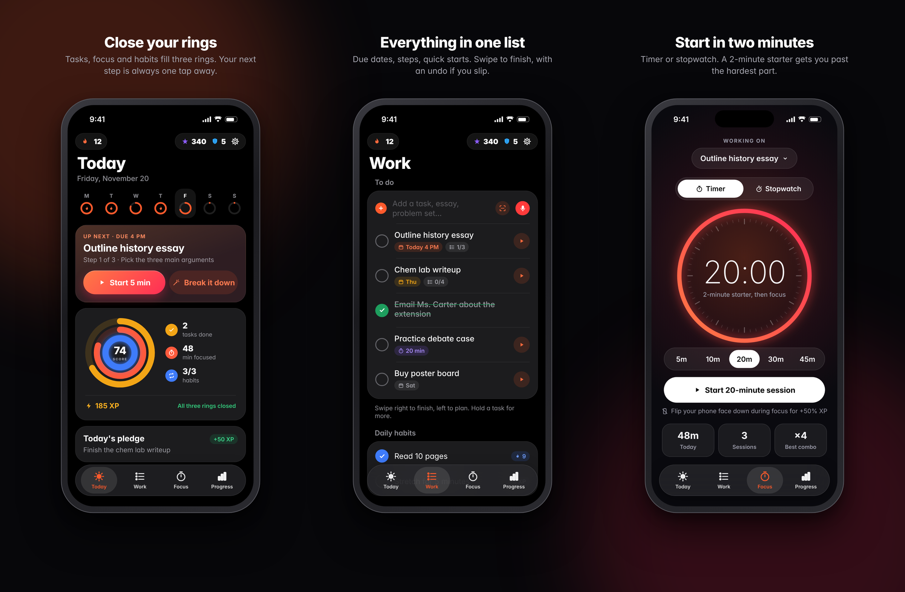
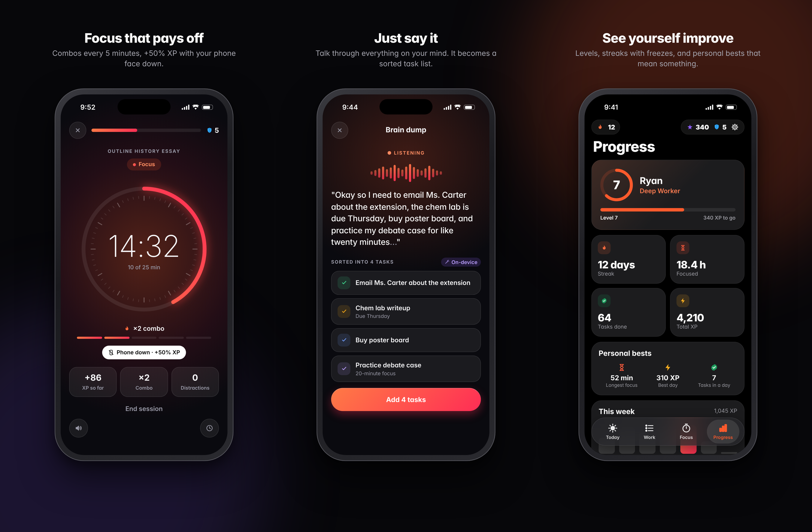
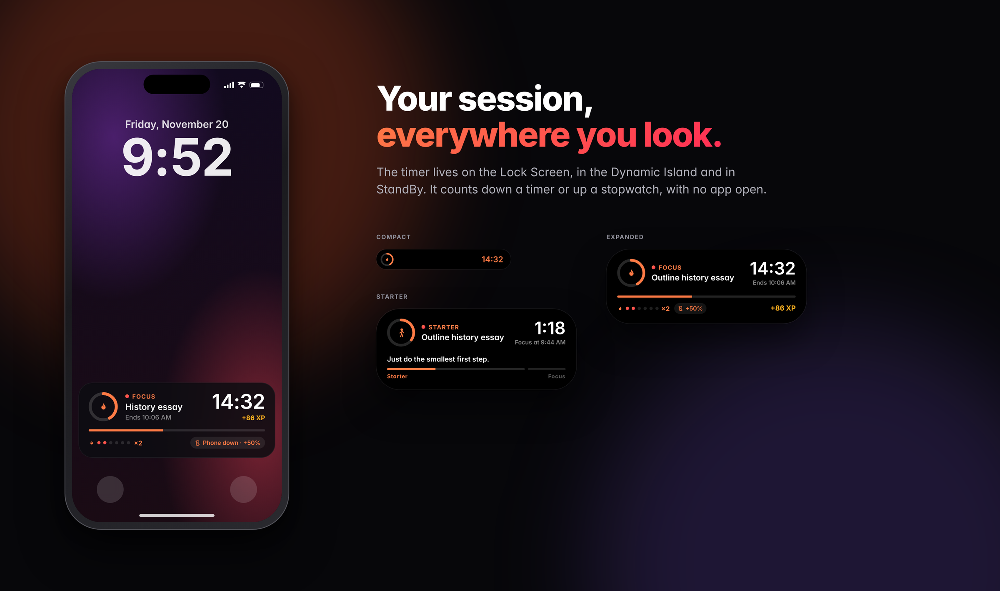
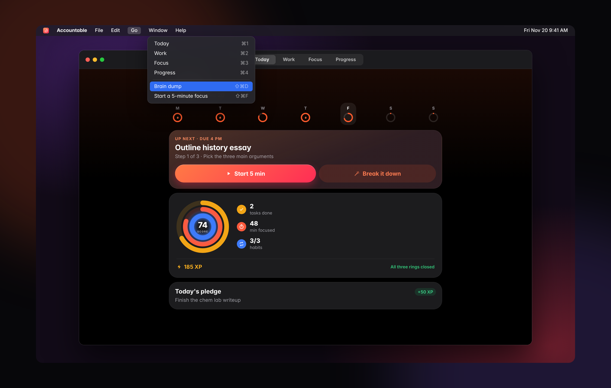

  

<h1 align="center">Accountable</h1>

  <b>The focus app for brains that won't start on their own.</b> 
  Tasks, focus sessions, habits and a little game layer, built for ADHD. 
  Native SwiftUI for iPhone and Mac.

  
  
  
  

  

---

## Why

Most to-do apps assume the hard part is remembering. For a lot of people the hard part is **starting**. Accountable is built around that:

- **A 2-minute starter** before every session, so the first step is tiny.
- **One clear next step**, always one tap from a 5-minute start.
- **Rewards for real progress**: XP, combos and personal bests come from focused time and finished tasks, not from opening the app.
- **Forgiving streaks**: freezes and shields mean one bad day doesn't wipe out a month.

## Screens

  

  

## Live Activities and the Dynamic Island

  

The running session follows you onto the Lock Screen, into the Dynamic Island and into StandBy. It counts down a timer or up a stopwatch, fills toward your next combo, and shows its own view during the 2-minute starter.

## On the Mac

  

The same project builds a Mac app through Mac Catalyst. It has a **Go** menu with keyboard shortcuts (⌘1–4 for tabs, ⇧⌘D for brain dump, ⇧⌘F for a quick focus) and a centred layout for wide windows.

## Features

| | |
|---|---|
| 🎙️ **Brain dump** | Say everything on your mind and it's sorted into tasks, using Apple Intelligence on device where available. You can also snap a photo or screenshot of an assignment. |
| 🪄 **Break it down** | Turns a big task into small, concrete steps. |
| 🎲 **Pick for me** | Can't decide? It picks the next thing for you. |
| ⏱️ **Timer and stopwatch** | Fixed-length rounds or open-ended focus, both with a 2-minute starter, combos every 5 minutes and +50% XP with your phone face down. |
| 🌧️ **Soundscapes** | Ten generated sounds (rain, thunder, waves, wind, birds, crickets, fire, café, brown noise, deep hum) with one-tap mixes. No audio files. |
| ⭕ **Day rings** | Tasks, focus and habits fill three rings. Close all three to finish the day. |
| 🔥 **Streaks, XP and levels** | Daily quests, loot drops, personal bests, streak freezes and shields. |
| ✅ **Habits** | Small daily habits that check off from the app or a widget. |
| 🧩 **Widgets** | Interactive Home Screen and Lock Screen widgets, including a StandBy focus timer. |
| 🎛️ **Controls** | Control Center, Lock Screen and Action button controls. |
| 🗣️ **Siri and Shortcuts** | Start a focus session or a brain dump by voice, or from any shortcut. |

## Install

You need a Mac with Xcode and a free Apple ID.

1. Clone the repo and open `Accountable.xcodeproj` in Xcode.
2. Plug in your iPhone and choose it as the run destination at the top. For the Mac version, choose **My Mac (Mac Catalyst)** instead.
3. In **Signing & Capabilities**, set your Apple ID as the Development Team on **both** targets: `Accountable` and `AccountableWidgets`.
4. Press **Run**.
5. On your iPhone, go to **Settings → General → VPN & Device Management** and trust your Apple ID. Turn on **Developer Mode** if iOS asks.

> [!NOTE]
> With a free Apple ID, apps expire after 7 days. Press **Run** again to refresh it.

<b>Build an IPA instead (for Sideloadly or AltStore)</b>

1. Install Xcode and open it once so it finishes installing its components.
2. Run `./build_ipa.sh` from the project folder.
3. Sign and install the resulting `Accountable.ipa` with [Sideloadly](https://sideloadly.io) or [AltStore](https://altstore.io) using your Apple ID.

<b>Widgets, controls and Siri setup</b>

- **Widgets:** long-press the Home Screen → Edit → Add Widget → Accountable. Habits, Tasks, Quick start, Brain dump, Focus timer (for StandBy), Streak, Focus score, Next step and Today.
- **Controls:** edit Control Center → Add a Control → Accountable. You'll find **Start focus** and **Brain dump** there.
- **Action button:** Settings → Action Button → Controls → Accountable.
- **Siri:** "Start a focus in Accountable" or "Brain dump in Accountable".

## Roadmap

- [ ] **iCloud sync** between iPhone and Mac (needs a paid Apple Developer account)
- [ ] **Screen Time controls** to block distracting apps during focus (same reason)
- [ ] TestFlight build

## Built with

SwiftUI · Observation · WidgetKit · ActivityKit · App Intents · Speech · Vision · VisionKit · AVAudioEngine · Foundation Models

---

Made by <a href="https://github.com/ryanlippman">Ryan Lippman</a>. The screenshots are high-fidelity renders of the app's screens.

